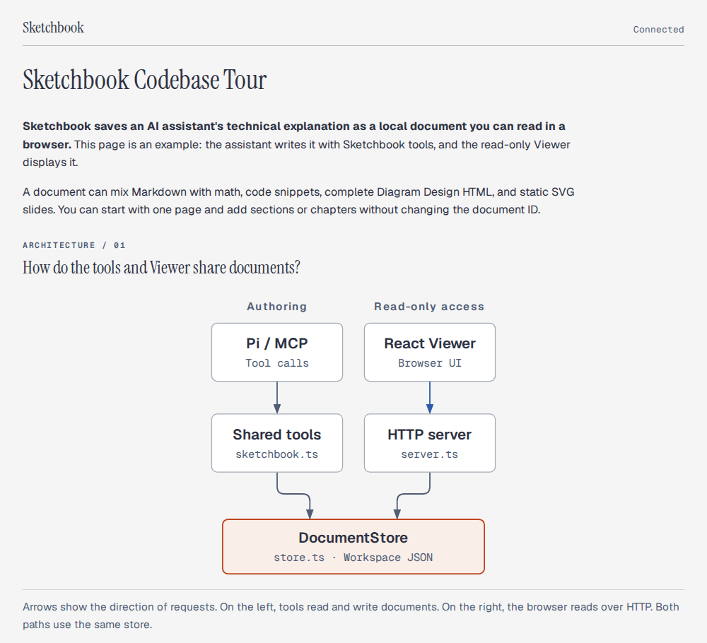

# Sketchbook

English · [繁體中文（台灣）](README.zh-TW.md)

Turn a technical explanation into a local page you can open in your browser. Mix Markdown, LaTeX, code, and diagrams. Start with one page, then add sections or chapters as the explanation grows.

Sketchbook runs in Pi, as a plugin for Claude Code or Codex, or as a standalone MCP server. It builds on [Diagram Design](https://github.com/cathrynlavery/diagram-design) for diagram authoring and bundles its guide, templates, and exporter.



## Try the demo

From a source checkout, install [just](https://just.systems/) and Node.js 26 or later. Run these commands from the repository root:

```sh
npm ci
just demo
```

Open either link printed in the terminal. The Diagram Atlas has 51 pages across two volumes, with a worked example for each diagram type. The text is in Traditional Chinese and the diagrams retain their English labels. The demo uses a temporary workspace and an HTTP Viewer bound to `127.0.0.1`; it does not read or write your Sketchbook documents. Press Ctrl+C to stop the Viewer and remove its temporary files.

## Installation

- [Pi](#pi): Install the extension and authoring skill.
- [Claude Code or Codex](#claude-code-and-codex-plugins): Install the plugin for the skill and MCP tools together.
- [Other MCP clients](#mcp): Configure the standalone server for tools only.

### Pi

Install from GitHub, then restart Pi or run `/reload`:

```sh
pi install https://github.com/narumiruna/sketchbook
```

Git installation requires Node.js 26.0.0 or later, Git, `tar`, and access to npm and GitHub. Pi uses npm to build the extension, Viewer, and skill on install and when `pi update https://github.com/narumiruna/sketchbook` changes the installed commit. Review the package before installing and the project declarations before granting Pi project trust.

Alternatively, install the prebuilt npm package. It may lag behind this repository:

```sh
pi install npm:@narumitw/sketchbook
```

When switching sources, run `pi remove <source>` for the old source first. For local development, run these commands from a checkout with the same build prerequisites:

```sh
npm ci
npm run build
pi install ./
```

See [compatibility evidence](docs/compatibility.md) for testing against Pi 1.6.0.

### Claude Code and Codex plugins

Build and install the tarball from this checkout to keep the skill and MCP server on the same version. Use Node.js 26.0.0 or later and run the following in the repository root:

```sh
npm ci
npm run build
archive=$(npm pack --quiet --ignore-scripts)
npm install --global "./$archive"
plugin_root="$(npm root --global)/@narumitw/sketchbook"
```

Make sure `sketchbook-mcp --help` works in the shell that launches your client. Register the plugin for the client you use:

```sh
# Claude Code
claude plugin marketplace add "$plugin_root"
claude plugin install sketchbook@narumi-sketchbook

# Codex CLI
codex plugin marketplace add "$plugin_root"
codex plugin add sketchbook@narumi-sketchbook
```

If you already configured the standalone MCP server, remove that entry to avoid loading it twice. Start a new session in the workspace where you want to save documents. Claude Code uses the project root. In the tested local setup, Codex starts the server in the CLI session's working directory. Both save under `.pi/sketchbook/` in that workspace.

### MCP

The standalone server works with stdio MCP clients such as Claude Desktop and Cursor. It does not require Pi. It exposes the tools available in the installed package version, not slash commands or automatic skill loading. For authoring guidance, see the [skill](skills/sketchbook/SKILL.md) and [document format](skills/sketchbook/references/document-format.md).

Run the published server from your workspace:

```sh
npx -y @narumitw/sketchbook --cwd .
```

Or add it to your client's MCP settings (for example, `claude_desktop_config.json` or `.cursor/mcp.json`). Set `--cwd` to an existing workspace directory and restart the client:

```json
{
  "mcpServers": {
    "sketchbook": {
      "command": "npx",
      "args": ["-y", "@narumitw/sketchbook", "--cwd", "/absolute/path/to/workspace"]
    }
  }
}
```

To pin the package, use `@narumitw/sketchbook@<version>`. To use this checkout, run `npm ci` and `npm run build` with Node.js 26.0.0 or later, then launch `node /absolute/path/to/sketchbook/dist/mcp-cli.js --cwd /absolute/path/to/workspace`.

#### MCP workspace and behavior

- `--cwd` is required in published version `0.2.2`. The current checkout uses the server process's working directory if you omit it. Relative paths resolve from that directory, which the client selects and which may differ from the open project. Save files go under `.pi/sketchbook/`; use a separate server configuration for each workspace you want to access.
- Stdout is reserved for MCP messages; diagnostics go to stderr. Results include JSON text and `structuredContent`, with `isError: true` on failures. Unlike Pi's bounded text preview, MCP returns the complete `sketchbook_read` record in both channels.
- `sketchbook_open` starts the read-only HTTP Viewer, not an HTTP MCP endpoint. A client disconnect, stdin EOF, SIGINT, or SIGTERM closes the Viewer.

See [MCP client handoff](docs/acceptance.md#mcp-client-handoff) for client-specific checks.

## Use

In Pi, invoke the skill with a prompt:

```text
/skill:sketchbook Explain this system with an overview, API detail, and storage detail.
```

This explicitly requests a saved page and a private Viewer link, even for a short question. The skill can use Markdown alone or save complete Diagram Design HTML when diagrams help. It uses Sketchbook's light style unless you specify a style or the project has a profile. Without an explicit request, simple questions that do not need a diagram should stay in chat. Automatic skill selection remains unverified.

### Tools

| Tool                   | Purpose                                                                                                                                                                    |
| ---------------------- | -------------------------------------------------------------------------------------------------------------------------------------------------------------------------- |
| `sketchbook_write`     | Create with `{document}` (omit `documentId` and `expectedRevision`). To replace the original page, pass `{document, documentId, expectedRevision}` with the full document. |
| `sketchbook_read`      | Read the original page and its revision with `{documentId}`.                                                                                                               |
| `sketchbook_open`      | Get a private, temporary Viewer URL with `{documentId}`. Open it in your browser; the tool does not launch one.                                                            |
| `sketchbook_read_book` | Read sections, extra chapters, and their revision with `{documentId}`. If `book` is `null`, the initial revision is `0`.                                                   |
| `sketchbook_edit`      | Make one revision-checked change with `{documentId, expectedRevision, operation}`.                                                                                         |

Read the record you intend to change and use its revision. If an edit conflicts or its result is uncertain, read that record again before retrying. Pi and MCP use the same validation and store the HTML and SVG sources unchanged. A successful write confirms validation and storage, not rendering; opening a URL does not verify rendering either. See the [document format and tool contract](skills/sketchbook/references/document-format.md) for result fields and limits.

### Grow a page into a book

A single page needs no cover or contents list. Add sections for named positions within a page. Add a chapter for a separate page; the original becomes the first chapter without changing its title, content, ID, or open link.

1. Before `add-section` or `add-chapter`, call `sketchbook_read_book`. Use `expectedRevision: 0` if `book` is `null`. Before the next edit, read again or use the revision returned by the previous edit.
2. Use `sketchbook_edit` to append blocks or slides without resending other content. Use `replace-block` only to replace an existing block. An edit to a block or slide with neither `chapterId` nor `sectionId` uses the original page's revision. All other edits use the book revision; omit `chapterId` to address the first chapter where that field is optional. The two revisions are independent, not a joint snapshot.
3. Navigate with the numbered contents or Previous/Next chapter controls. Section links jump within the current chapter. A page with only sections lists just those sections. On wide screens the contents stay in a left sidebar; on narrow screens they appear above the page.

Chapter and section links use stable IDs in the `chapter` and `section` query parameters. Keep the original token in the URL fragment after the query. A link without those parameters opens the first page. Renaming or reordering a chapter does not change its ID. See [edit operations](skills/sketchbook/references/document-format.md#edit-operations) and [book verification](docs/acceptance.md#progressive-sketchbook-handoff).

## Content types

### Add Diagram Design HTML

To import a diagram, add a `diagram-html` block with an `id`, `title`, and the complete self-contained HTML in `html`. You can place it on the original page, in a section, or in another chapter. The Viewer keeps the drawings, typography, and captions together without adding a frame or diagram controls. Importing and viewing HTML do not require Python. If your MCP client does not load the skill, use your own authoring workflow. See the [HTML policy](skills/sketchbook/references/document-format.md#diagram-design-html).

### Add a code snippet

For a standalone snippet, add a `code` block to `document.blocks`:

```json
{ "id": "example", "type": "code", "language": "TypeScript", "code": "const answer = 42;\n" }
```

Omit `language` to hide the label. The Viewer shows code as text and never runs it. Tab to the block and use the arrow keys to scroll long lines. For code within prose or a slide explanation, use a fenced Markdown block.

## Rendering and security

- **Diagram Design HTML:** The Viewer sandboxes imported pages and works offline. Scripts, navigation, and external resources are not supported. External stylesheets are removed; embedded styles and local SVG definitions stay with the page.
- **Static SVG decks:** Each deck shows one slide and its explanation at a time, independently of chapter navigation. Use the Previous/Next buttons, labelled dots, or Left/Right keys when the deck has focus. On wide screens, the explanation sits beside the slide; on narrow screens, it appears in one reading column and wide drawings scroll locally. Slides are isolated images with no diagram toolbar.
- **Markdown and math:** Markdown supports inline and display LaTeX, fenced code, and footnotes, but not raw HTML or images. Footnote targets are local to each block or slide explanation. In-page links move focus without replacing the Viewer token. KaTeX uses `trust: false`, `maxExpand: 1000`, and `maxSize: 20`.
- **Layout and fonts:** The Viewer uses Diagram Design's light palette and typography. To align an imported page with the book's reading column, add `class="sketchbook-default-layout"` to `<body>`. Other imported pages keep their own margins, width, and colors. Fonts, notices, styles, scripts, and renderers ship with the Viewer. Instrument Serif, Geist, Geist Mono, and Traditional Chinese Noto fonts work without a CDN; missing glyphs use system fallbacks.
- **Render errors:** An error in supported content does not remove the rest of the document. Rendering runs on the browser's main thread; error handling does not isolate CPU use.

### Article review

Check the heading outline before reviewing diagrams. The page title is H1; deck and current slide titles are H2 and H3 (H3 and H4 inside a named section). Matching deck and slide titles appear once visually. Define terms before using them and use names consistently. Give each diagram one question, then check arrows, outcomes, and order against the source. At desktop width and 390px, check readable labels, text wrapping, and local scrolling in every chapter and section at the authored scale. Report saving, rendering, readability, source correctness, and human acceptance separately.

### LAN access

Use the complete `sketchbook_open` URL on another device on the **same trusted LAN**. No manual IP or host flag is needed. Keep the full URL private: its fragment contains a token that permits document reads across that workspace, not just for the linked document. HTTP is unencrypted. Do not expose or forward the port to the Internet, and keep secrets out of documents.

The Viewer listens on all IPv4 interfaces (`0.0.0.0`) on a random port. The URL uses the first detected non-internal private IPv4 address in system interface order, or `127.0.0.1` if none is found. The fallback does not restrict the listener to loopback, and IPv6 is not supported. Host and Origin checks and the Content Security Policy (CSP) restrict browser access but do not filter client IPs. Follow your firewall policy. See the [Viewer access rules](skills/sketchbook/references/document-format.md#open) for allowed addresses, ports, and origins.

VPNs, virtual interfaces, firewalls, and Wi-Fi isolation can prevent another device from connecting. After a network or DHCP change, reload Pi and open a fresh link. If you changed this checkout, rebuild with `npm run build` before reloading. See the [LAN device handoff](docs/acceptance.md#lan-device-handoff) for checks on a second device.

## Files and lifecycle

- The original page lives at `.pi/sketchbook/<documentId>.json`. Sections and extra chapters live in the optional `<documentId>.book.json` alongside it. Supported records need no migration; replacing the original page leaves the book file unchanged. Sketchbook creates a local `.pi/sketchbook/.gitignore`, not a workspace-root rule.
- Writes check revisions, queue changes per record within one process, and use atomic rename. There is no cross-process lock or transaction spanning both files. Do not write the same document from multiple Pi or MCP processes.
- Only `sketchbook_open` starts the Viewer. Pi TUI and RPC can open it; print and JSON modes can only read and write. Stopping Pi or the MCP server invalidates the links without deleting files. Open again after reload, new, resume, or fork. Session history does not undo writes; create a new document ID for a separate branch of the content.
- Physical second-device access, remote SSH, container forwarding, and WSLg or Windows browser access need separate verification.

## Upgrade from Pi Canvas

Use `@narumitw/sketchbook`, `sketchbook_*` tools, and `/skill:sketchbook`. The old `canvas_*` tools and `/skill:canvas-explain-diagrams` are not aliases. Replace `/skill:sketchbook-create-diagrams`, `/skill:sketchbook-diagram-design`, and `/skill:sketchbook-explain-diagrams` in saved prompts as well.

Sketchbook does not move `.pi/canvas/` automatically. Stop all Pi sessions in that workspace and back up the files first. If `.pi/sketchbook/` does not exist, move the entire `.pi/canvas/` directory there. If both exist, keep both and resolve conflicting document IDs before moving files. Do not overwrite either directory. IDs, revisions, and schema version 1 stay the same. Restart Pi and reopen the documents for new URLs.

## Open older books

Schema version 1 still supports Markdown, code, Diagram Design HTML, and static SVG slides. The legacy `defaultDiagramSource` field is accepted but ignored. Omit it in new documents.

Mermaid slides prevent the Viewer from opening a book. It will not skip, convert, or rewrite them. If only the book file contains Mermaid, you can still read the original page if its content is supported.

Back up all of `.pi/sketchbook/`, including both `.json` and `.book.json` records. The last verified reader for the full older format is revision `10bc8574615c77f5e2d229850a4340c29cb2bae7`. In a separate recovery checkout of that revision, run the following with Node.js 26:

```sh
npm ci
npm run build
npm pack
```

Install the resulting tarball or point your MCP client at the recovery checkout's `dist/mcp-cli.js`. Open a backup copy first. This reader also supports Diagram Design HTML and static SVG. If you redraw a Mermaid book, save it as a new book.

## Verify

Source builds, including Git installation, use `tar` and network access to download and verify the pinned Diagram Design archive. The build bundles the guide, templates, exporter, and notices. The prebuilt npm package does not download that archive.

From the repository root, use Node.js 26.0.0 or later:

```sh
npm ci
npm run ci
npx playwright install chromium
npm run test:browser -- --output=test-results/browser
npm pack --dry-run
npm run test:package
```

If Chromium's system libraries are missing on Linux, use `npx playwright install --with-deps chromium`. The browser output directory keeps review captures separate. The package smoke test checks Git installation and update in a disposable repository, the npm tarball, and the local checkout without changing your Pi settings.

To enable Git hooks, run `prek install` with [prek](https://prek.j178.dev/). If `git config --local --get core.hooksPath` still reports `.husky/_`, run `git config --local --unset core.hooksPath` first. After `npm ci`, `prek run --all-files` runs Biome, type-checks `tsconfig.tests.json` with its own `tsc-rs`, and audits `.github` with `zizmor --pedantic --fix .github`. Only Zizmor can write fixes; review and stage them before retrying a commit.

See [compatibility evidence](docs/compatibility.md) for measured results and [acceptance](docs/acceptance.md) for human checks, authorized model tests, and release-owner actions. Automated tests do not establish visual acceptance or reliable automatic skill selection. The release workflow creates tags and GitHub Releases, but does not publish to npm.

## Scope and license

Sketchbook does not provide cloud sharing, accounts, live collaboration, browser editing, nested chapters or sections, version history, restore, autoplay, export, or HTTP MCP transport.

Sketchbook is licensed under the [MIT License](LICENSE). Bundled third-party files retain their own licenses.
