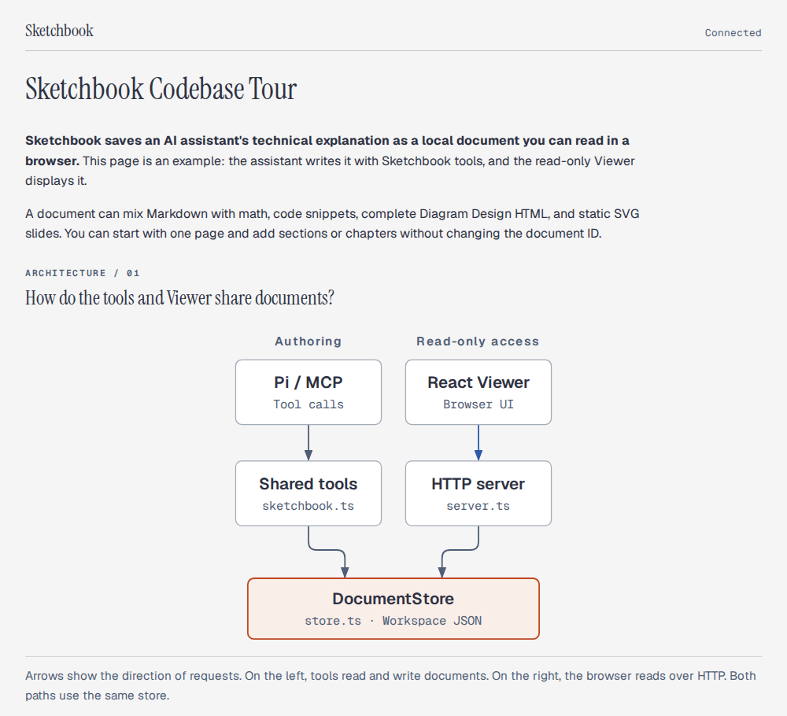

# Sketchbook

[English](README.md) · 繁體中文（台灣）

把技術解說做成可以在瀏覽器開啟的本機頁面。你可以混用 Markdown、LaTeX、程式碼和圖表，從一頁開始，再視需要加入小節或章節。

Sketchbook 可在 Pi 使用，也提供 Claude Code 和 Codex 外掛，以及獨立的 MCP 伺服器。圖表製作以 [Diagram Design](https://github.com/cathrynlavery/diagram-design) 為基礎，並隨附它的指南、範本與匯出工具。



## 試用展示

從原始碼工作副本試用時，先安裝 [just](https://just.systems/) 和 Node.js 26 以上版本，再從儲存庫根目錄執行：

```sh
npm ci
just demo
```

在瀏覽器開啟終端機列出的任一連結。《圖型實用圖鑑》分上下冊，共 51 頁，每頁各有一種圖型的案例。正文是繁體中文，圖面保留英文標籤。展示使用暫存工作區，HTTP Viewer 只監聽 `127.0.0.1`，不會讀寫你的 Sketchbook 文件。按 Ctrl+C 可關閉 Viewer 並清理暫存檔。

## 安裝

- [Pi](#pi)：安裝擴充功能和撰寫 skill。
- [Claude Code 或 Codex](#claude-code-和-codex-外掛)：安裝外掛，一次取得 skill 和 MCP 工具。
- [其他 MCP 用戶端](#mcp)：如果只需要工具，請設定獨立伺服器。

### Pi

從 GitHub 安裝後，重新啟動 Pi 或執行 `/reload`：

```sh
pi install https://github.com/narumiruna/sketchbook
```

透過 Git 安裝需要 Node.js 26.0.0 以上版本、Git、`tar`，且必須能連線到 npm 和 GitHub。Pi 在安裝時會用 npm 建置擴充功能、Viewer 和 skill；使用 `pi update https://github.com/narumiruna/sketchbook` 更新到不同的 commit 時，也會重新建置。安裝前請先檢視套件；在 Pi 中信任專案前，也請檢視專案設定。

也可以安裝預先建置的 npm 套件，但版本可能落後於此儲存庫：

```sh
pi install npm:@narumitw/sketchbook
```

切換來源前，先用 `pi remove <source>` 移除舊的套件。若要從本機開發工作副本安裝，請先準備相同的建置環境，再執行：

```sh
npm ci
npm run build
pi install ./
```

Sketchbook 使用 Pi 1.6.0 測試，詳見[相容性驗證紀錄](docs/compatibility.md)。

### Claude Code 和 Codex 外掛

從這份工作副本建置並安裝壓縮套件，讓 skill 和 MCP 伺服器使用同一版本。請使用 Node.js 26.0.0 以上版本，在儲存庫根目錄執行：

```sh
npm ci
npm run build
archive=$(npm pack --quiet --ignore-scripts)
npm install --global "./$archive"
plugin_root="$(npm root --global)/@narumitw/sketchbook"
```

確認啟動用戶端的 shell 能執行 `sketchbook-mcp --help`，再向你使用的用戶端註冊外掛：

```sh
# Claude Code
claude plugin marketplace add "$plugin_root"
claude plugin install sketchbook@narumi-sketchbook

# Codex CLI
codex plugin marketplace add "$plugin_root"
codex plugin add sketchbook@narumi-sketchbook
```

如果已設定獨立的 MCP 伺服器，請移除那筆設定，以免重複載入。從想儲存文件的工作區啟動新的工作階段。Claude Code 使用專案根目錄；在已測試的本機環境中，Codex 會在 CLI 工作階段的工作目錄啟動伺服器。兩者都會將文件存到該工作區的 `.pi/sketchbook/`。

### MCP

獨立伺服器可搭配 Claude Desktop、Cursor 等支援 stdio 的 MCP 用戶端使用，不需要 Pi。可用工具取決於已安裝的套件版本；不提供斜線指令，也不會自動載入 skill。撰寫文件時，可參考 [skill](skills/sketchbook/SKILL.md) 和[文件格式](skills/sketchbook/references/document-format.md)。

在工作區執行已發布的伺服器：

```sh
npx -y @narumitw/sketchbook --cwd .
```

也可以把伺服器加入用戶端的 MCP 設定，例如 `claude_desktop_config.json` 或 `.cursor/mcp.json`。將 `--cwd` 設為既有的工作區目錄，然後重新啟動用戶端：

```json
{
  "mcpServers": {
    "sketchbook": {
      "command": "npx",
      "args": ["-y", "@narumitw/sketchbook", "--cwd", "/absolute/path/to/workspace"]
    }
  }
}
```

若要固定套件版本，請用 `@narumitw/sketchbook@<version>`。若要使用這份工作副本，請用 Node.js 26.0.0 以上版本執行 `npm ci` 和 `npm run build`，再執行 `node /absolute/path/to/sketchbook/dist/mcp-cli.js --cwd /absolute/path/to/workspace`。

#### MCP 工作區和行為

- 已發布的 `0.2.2` 版必須指定 `--cwd`。目前的工作副本若省略它，會使用伺服器程序的工作目錄。相對路徑也以該目錄為準。工作目錄由用戶端選定，不一定是目前開啟的專案。文件會存到 `.pi/sketchbook/`；每個要存取的工作區都需要獨立的伺服器設定。
- 標準輸出（stdout）專供 MCP 訊息使用；診斷訊息寫到標準錯誤（stderr）。工具會回傳 JSON 文字和 `structuredContent`，失敗時會設定 `isError: true`。Pi 的文字預覽有長度限制，MCP 則會在兩種回傳格式中提供完整的 `sketchbook_read` 紀錄。
- `sketchbook_open` 啟動的是唯讀的 HTTP Viewer，不是 HTTP MCP 端點。用戶端中斷連線、標準輸入到達檔案結尾（EOF），或程序收到 SIGINT 或 SIGTERM 時，Viewer 就會關閉。

各用戶端的檢查方式請參閱 [MCP 用戶端驗收](docs/acceptance.md#mcp-client-handoff)。

## 使用方式

在 Pi 中，輸入 `/skill:sketchbook`，再接上你的問題：

```text
/skill:sketchbook 請先概述這個系統，再說明 API 和資料儲存的細節。
```

即使問題很短，這個指令也會明確要求儲存頁面，並提供私有的 Viewer 連結。頁面可以只用 Markdown；適合用圖解時，skill 會儲存完整的 Diagram Design HTML。未指定樣式且專案沒有樣式設定時，會用 Sketchbook 的淺色樣式。未明確要求時，不需圖解的簡單問題應直接在對話中回答。skill 的自動選用仍未驗證。

### 工具

| 工具                   | 用途                                                                                                                                                |
| ---------------------- | --------------------------------------------------------------------------------------------------------------------------------------------------- |
| `sketchbook_write`     | 用 `{document}` 建立文件（省略 `documentId` 和 `expectedRevision`）。要替換原始頁面，請用 `{document, documentId, expectedRevision}` 傳入完整文件。 |
| `sketchbook_read`      | 用 `{documentId}` 讀取原始頁面和修訂版號。                                                                                                          |
| `sketchbook_open`      | 用 `{documentId}` 取得暫時有效的私有 Viewer 網址。請自行在瀏覽器開啟；工具不會啟動瀏覽器。                                                          |
| `sketchbook_read_book` | 用 `{documentId}` 讀取小節、額外章節和修訂版號。若 `book` 是 `null`，初始修訂版號為 `0`。                                                           |
| `sketchbook_edit`      | 用 `{documentId, expectedRevision, operation}` 進行一次會檢查修訂版號的編輯。                                                                       |

先讀取要修改的紀錄，再用該紀錄的修訂版號編輯。如果發生衝突或結果不明，請先重新讀取同一筆紀錄，再決定是否重試。Pi 和 MCP 使用相同的驗證規則，並原樣儲存 HTML 和 SVG 原始碼。寫入成功只代表資料已通過驗證並儲存；取得網址也不代表已驗證顯示結果。回傳欄位和限制請參閱[文件格式和工具規格](skills/sketchbook/references/document-format.md)。

### 從單頁擴充成書

單頁不需要封面或目錄。加入小節可讓讀者跳到頁面上的指定位置；需要獨立頁面時，再加入章節。原始頁面會成為第一章，標題、內容、ID 和原本的連結都不變。

1. 執行 `add-section` 或 `add-chapter` 前，先呼叫 `sketchbook_read_book`。如果 `book` 是 `null`，請用 `expectedRevision: 0`。下次編輯前重新讀取，或使用上次編輯回傳的修訂版號。
2. 用 `sketchbook_edit` 加入區塊或投影片，不必重送其他內容。只有要替換現有區塊時，才用 `replace-block`。編輯區塊或投影片時，若同時省略 `chapterId` 和 `sectionId`，請用原始頁面的修訂版號；其他編輯使用書籍的修訂版號。若 `chapterId` 為選填，省略它可指定第一章。兩個修訂版號各自獨立，不代表共同快照。
3. 用編號目錄或上一章、下一章按鈕切換章節。小節連結會跳到目前章節內的對應位置。只有小節的頁面，目錄只列出小節。寬螢幕的目錄固定在左側；窄螢幕的目錄顯示在頁面上方。

章節和小節的連結會在 `chapter` 和 `section` 查詢參數中使用固定 ID。請把原本的存取權杖留在查詢字串後的 URL 片段中。未帶這兩個參數的連結仍會開啟第一頁。章節改名或重新排序時，ID 不會改變。詳見[編輯操作](skills/sketchbook/references/document-format.md#edit-operations)和[書籍驗收](docs/acceptance.md#progressive-sketchbook-handoff)。

## 內容類型

### 加入 Diagram Design HTML

匯入圖表時，加入一個 `diagram-html` 區塊，指定 `id` 和 `title`，並把完整且不依賴外部資源的 HTML 放入 `html`。可以把區塊放在原始頁面、小節或其他章節。Viewer 會保留圖形、排版與圖說，不會額外加上圖框或圖表操作工具。匯入或檢視 HTML 不需要 Python。如果 MCP 用戶端不會載入 skill，請自行安排撰寫流程。詳見 [HTML 規則](skills/sketchbook/references/document-format.md#diagram-design-html)。

### 加入程式碼片段

若要單獨展示程式碼片段，請在 `document.blocks` 加入 `code` 區塊：

```json
{ "id": "example", "type": "code", "language": "TypeScript", "code": "const answer = 42;\n" }
```

省略 `language` 就不會顯示語言標籤。Viewer 只會將程式碼顯示為文字，不會執行。用 Tab 把焦點移到區塊，再用方向鍵捲動長行。若要在正文或投影片說明中插入程式碼，請用 Markdown 程式碼區塊。

## 算繪和安全性

- **Diagram Design HTML：** Viewer 在沙箱中顯示匯入的頁面，可離線使用。不支援指令碼、頁面導覽或外部資源。外部樣式表會被移除，內嵌樣式與本機 SVG 定義則會保留。
- **靜態 SVG 投影片組：** 每組一次顯示一張投影片和它的說明，切換投影片不會改變所在章節。可用上一張、下一張按鈕、帶標籤的定位圓點，或在投影片組取得焦點後使用左右方向鍵。寬螢幕將說明放在圖旁；窄螢幕使用單欄版面，較寬的圖可在區塊內捲動。投影片是獨立圖片，不提供圖表工具列。
- **Markdown 和數學式：** 支援行內與區塊 LaTeX、程式碼區塊和註腳，不支援原始 HTML 或圖片。註腳只能連到同一區塊或投影片說明內的目標。頁內連結會移動焦點，不會替換 Viewer 權杖。KaTeX 使用 `trust: false`、`maxExpand: 1000` 和 `maxSize: 20`。
- **版面和字型：** Viewer 使用 Diagram Design 的淺色配色與排版。匯入的 HTML 會保留原有的邊距、寬度和配色；若要對齊書籍的閱讀欄，請在 `<body>` 加上 `class="sketchbook-default-layout"`。Viewer 隨附字型、授權聲明、樣式、指令碼和算繪元件。Instrument Serif、Geist、Geist Mono 和繁體中文 Noto 不需透過 CDN 載入；缺字時會改用系統字型。
- **算繪錯誤：** 受支援的內容若發生錯誤，不會移除文件的其他部分。算繪在瀏覽器的主執行緒進行，錯誤處理不會隔離 CPU 資源。

### 審閱文章

先確認標題層級，再審閱圖表。頁面標題是 H1；投影片組和目前投影片的標題依序為 H2、H3，在具名小節內則為 H3、H4。兩個標題相同時，畫面上只會顯示一次。先定義術語再使用，並保持用詞一致。每張圖只回答一個問題，並對照來源檢查箭頭、結果和順序。在桌面寬度及 390px 下，以原始設計比例檢查每個章節和小節的標籤可讀性、文字換行和區塊內捲動。分別回報儲存、算繪、可讀性、內容是否符合來源，以及人工驗收結果。

### 區域網路存取

請在**同一個可信任的區域網路（LAN）**上，用另一部裝置開啟 `sketchbook_open` 回傳的完整網址。不必手動輸入 IP 或指定主機參數。請勿公開完整網址：URL 片段中的權杖可讀取該工作區的文件，不只連結指定的文件。HTTP 未加密。不要在文件中放入機密資料，也不要將連接埠開放或轉送到網際網路。

Viewer 會在所有 IPv4 介面（`0.0.0.0`）的隨機連接埠監聽。回傳的網址會依系統列出的介面順序，使用第一個偵測到的非內部私有 IPv4 位址；若找不到，才使用 `127.0.0.1`。使用備用位址時，監聽範圍也不會限於本機迴路。不支援 IPv6。`Host` 和 `Origin` 檢查及內容安全政策（CSP）會限制瀏覽器存取，但不會過濾用戶端 IP。請遵守防火牆政策。允許的位址、連接埠和來源詳見 [Viewer 存取規則](skills/sketchbook/references/document-format.md#open)。

VPN、虛擬網路介面、防火牆或 Wi-Fi 用戶端隔離可能阻擋其他裝置連線。網路或 DHCP 分配的位址變更後，請重新載入 Pi，再開啟文件取得新連結。若變更了這份工作副本，請在重新載入前執行 `npm run build`。第二部裝置的檢查方式請參閱[區域網路裝置驗收](docs/acceptance.md#lan-device-handoff)。

## 檔案與生命週期

- 原始頁面存於 `.pi/sketchbook/<documentId>.json`。小節和額外章節存於同一目錄下的選用檔案 `<documentId>.book.json`。受支援的紀錄不須移轉；替換原始頁面不會變更書籍檔案。Sketchbook 只建立 `.pi/sketchbook/.gitignore`，不修改工作區根目錄的規則。
- 寫入時會檢查修訂版號，在同一程序內依紀錄排隊，並用原子性重新命名儲存。沒有跨程序鎖定，也沒有同時涵蓋兩個檔案的交易。不要從多個 Pi 或 MCP 程序寫入同一份文件。
- 只有 `sketchbook_open` 會啟動 Viewer。Pi 的 TUI 和 RPC 工作階段可以開啟 Viewer；print 和 JSON 模式只能讀寫。停止 Pi 或 MCP 伺服器會使連結失效，但不會刪除檔案。重新載入、新建、繼續或分叉工作階段後，請重新開啟文件。工作階段歷史不會復原寫入；若要保留另一個文件版本，請用新的文件 ID。
- 第二部實體裝置的存取、遠端 SSH、容器連接埠轉送，以及 WSLg 或 Windows 瀏覽器存取，都要另外驗證。

## 從 Pi Canvas 升級

請改用 `@narumitw/sketchbook`、`sketchbook_*` 工具和 `/skill:sketchbook`。舊的 `canvas_*` 工具和 `/skill:canvas-explain-diagrams` 不是別名。也請替換已儲存提示中的 `/skill:sketchbook-create-diagrams`、`/skill:sketchbook-diagram-design` 和 `/skill:sketchbook-explain-diagrams`。

Sketchbook 不會自動搬移 `.pi/canvas/`。請先停止該工作區的所有 Pi 工作階段並備份檔案。若 `.pi/sketchbook/` 不存在，請把整個 `.pi/canvas/` 搬到該路徑。如果兩個目錄都存在，請保留兩者，先處理重複的文件 ID，再搬移檔案；不要覆寫任一目錄。ID、修訂版號和結構描述版本 1 都不變。重新啟動 Pi，再開啟文件取得新網址。

## 開啟舊版書籍

結構描述版本 1 仍支援 Markdown、程式碼、Diagram Design HTML 和靜態 SVG 投影片。系統會接受但忽略舊的 `defaultDiagramSource` 欄位；新文件請省略它。

只要書中有 Mermaid 投影片，Viewer 就無法開啟整本書，也不會跳過、轉換或改寫這些投影片。如果只有書籍檔案包含 Mermaid，且原始頁面的內容仍受支援，就還是可以單獨讀取原始頁面。

請備份整個 `.pi/sketchbook/`，包括 `.json` 和 `.book.json` 紀錄。最後一個已驗證能完整讀取舊格式的版本是 `10bc8574615c77f5e2d229850a4340c29cb2bae7`。請另外取用該版本的工作副本，使用 Node.js 26 執行：

```sh
npm ci
npm run build
npm pack
```

安裝產生的壓縮套件，或把 MCP 用戶端指向復原工作副本的 `dist/mcp-cli.js`。請先開啟備份副本。此版本也支援 Diagram Design HTML 和靜態 SVG。若重繪含 Mermaid 的書籍，請另存成一本新書。

## 驗證

從原始碼建置（包括 Git 安裝）需使用 `tar` 和網路，才能下載並驗證固定版本的 Diagram Design 壓縮檔。指南、範本、匯出工具和授權聲明都會打包。預先建置的 npm 套件不會下載該壓縮檔。

請用 Node.js 26.0.0 以上版本，在儲存庫根目錄執行：

```sh
npm ci
npm run ci
npx playwright install chromium
npm run test:browser -- --output=test-results/browser
npm pack --dry-run
npm run test:package
```

若 Linux 缺少 Chromium 所需的系統函式庫，請用 `npx playwright install --with-deps chromium`。瀏覽器測試的輸出目錄可將審閱用的擷取結果分開存放。套件測試會在臨時儲存庫檢查 Git 安裝及更新，也會測試 npm 壓縮套件和本機工作副本，不會修改你的 Pi 設定。

若要啟用 Git hooks，請安裝 [prek](https://prek.j178.dev/) 並執行 `prek install`。如果 `git config --local --get core.hooksPath` 仍回報 `.husky/_`，請先執行 `git config --local --unset core.hooksPath`。執行 `npm ci` 後，`prek run --all-files` 會執行 Biome、用 hook 環境內的 `tsc-rs` 檢查 `tsconfig.tests.json` 的型別，並用 `zizmor --pedantic --fix .github` 稽核 `.github`。只有 Zizmor 會寫入修正；重新提交前請先檢視，再加入暫存區。

測試結果請參閱[相容性驗證紀錄](docs/compatibility.md)；人工檢查、需授權的模型測試和發行負責人操作請參閱[驗收指南](docs/acceptance.md)。自動測試無法證明畫面已通過人工驗收，也無法證明 skill 能可靠地自動選用。發行工作流程會建立版本標籤和 GitHub Releases，但不會發布到 npm。

## 功能範圍和授權

Sketchbook 不提供雲端分享、帳號、即時協作、瀏覽器內編輯、巢狀章節或小節、版本歷史、還原、自動播放、匯出或 HTTP MCP 傳輸。

Sketchbook 採用 [MIT 授權](LICENSE)。隨附的第三方檔案仍適用各自的授權條款。
